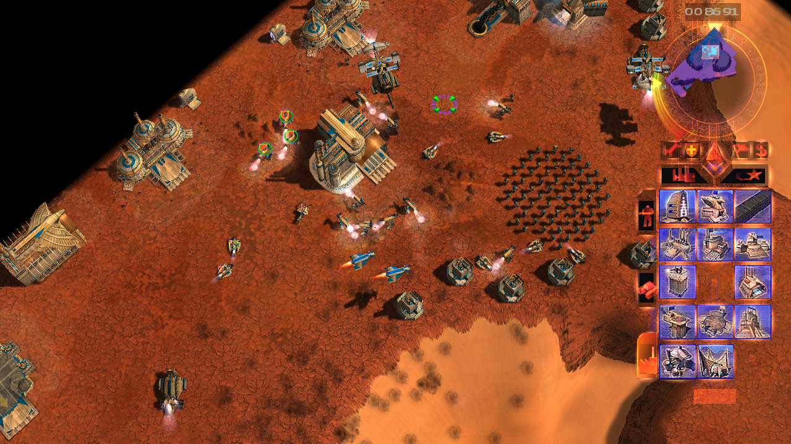
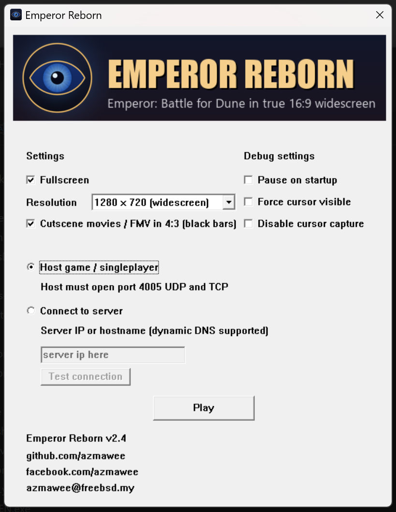

# Emperor Reborn

**[Deutsch](#deutsch) · [English](#english)**




---

## Deutsch

Emperor Reborn ist ein kostenloser Open-Source-Launcher, mit dem *Emperor: Schlacht um Dune* /
*Emperor: Battle for Dune* (Westwood, 2001) auf aktuellem Windows läuft: echtes 16:9-Breitbild,
Vollbild-Skalierung und funktionierender Multiplayer. Getestet unter Windows 11, Windows 10 sollte
ebenfalls funktionieren.

Diese Version ist ein Fork von [azmawee/EmperorReborn](https://github.com/azmawee/EmperorReborn) und
ergänzt:

- **Installation von den deutschen CDs** (*Emperor: Schlacht um Dune*) mit dem deutschen Patch
  `EM109DE.EXE`. Die englischen CDs funktionieren weiterhin.
- **Launcher auf Deutsch und Englisch**, umschaltbar im Launcher unter *Sprache / Language*. Ohne
  Auswahl richtet sich die Sprache nach Windows.
- **Prüfung der `Game.exe` vor dem Start:** Statt eines Absturzes gibt es eine verständliche Warnung,
  falls die `Game.exe` nicht zu v1.09 passt.

### Download

Fertige Builds gibt es unter
[Releases](https://github.com/HerrSpigot/EmperorReborn/releases). Sie werden automatisch per GitHub
Actions aus diesem Repository gebaut. Die ZIP-Datei enthält `EmperorReborn.exe`, `EmperorHooks.dll`,
die Anleitung und `SHA256SUMS.txt`.

### Was du brauchst

- Windows 10 oder 11.
- Deine eigenen vier Emperor-CDs (deutsch oder englisch), als echte CDs oder eingebundene Images.
- Den offiziellen Patch v1.09 **in der Sprache deiner CDs**:
  - deutsche CDs: `EM109DE.EXE`
  - englische CDs: `EM109EN.EXE`

  Der Patch ist urheberrechtlich geschützt (EA/Westwood) und deshalb nicht enthalten. Er war ein
  kostenloser Download und lässt sich über den Dateinamen finden. Lade ihn nur aus einer Quelle, der du
  vertraust.

Eine VC++-Runtime ist nicht nötig.

### Installation

1. ZIP entpacken, z. B. nach `C:\Games\EmperorReborn\`. Der Pfad darf **keine Umlaute oder
   Sonderzeichen** enthalten.
2. Den Patch (`EM109DE.EXE`) in denselben Ordner legen wie `EmperorReborn.exe` und `EmperorHooks.dll`.
3. `EmperorReborn.exe` starten. Beim ersten Start fragt der Launcher nacheinander nach den CDs:
   CD 1 (Installation), dann Atreides, Harkonnen und Ordos. Er erkennt die CDs am Inhalt; bei den
   Haus-CDs fragt er einmal nach, welche gerade eingelegt ist. Daraus baut er eine eigene, saubere
   Spielkopie im Unterordner `data`. Eine bestehende Installation wird nicht angefasst.
4. Im Launcher Auflösung und Vollbild wählen, dann **Spielen**.

Die Einrichtung passiert nur einmal. Eine ausführliche Anleitung steht in [`INSTALL.txt`](INSTALL.txt).

<p align="center"></p>

### Funktionen

- **Echtes 16:9-Breitbild.** Das Schlachtfeld wird im richtigen Seitenverhältnis gezeigt, nicht
  gestreckt oder abgeschnitten. Seitenleiste, Mauszeiger, Rand-Scrollen und Menüs passen dazu. Das
  HUD-Layout im Einsatz basiert auf Moros Widescreen-Patch.
- **Vollbild-Skalierung.** Die gewählte Auflösung füllt den ganzen Bildschirm.
- **Hochskalierte Modi mit großer UI** für 4K-Monitore: Der Desktop bleibt in seiner Auflösung, das
  Spiel rendert in 2560x1440, 1920x1080 oder 1280x720 und wird hochskaliert.
- **Zwischensequenzen in 4:3** mit schwarzen Balken (abschaltbar).
- **Flüssiges Karten-Scrollen**, unabhängig von der Bildrate.
- **Multiplayer per IP oder Hostname** (auch dynamisches DNS), da Westwood Online abgeschaltet ist.

### Auflösung

| Auflösung | Hinweis |
|---|---|
| `1280 x 720 (Breitbild)` | Standard, gut lesbare Schrift |
| `1600 x 900 (Breitbild)` | schärfer |
| `1920 x 1080 (Breitbild)` | scharf, kleinere UI |
| `2560 x 1440 (Breitbild)` | am schärfsten |
| `640 x 480` bis `1152 x 864` | Original-Modi in 4:3 |
| `Desktop` | native Auflösung, UI auf 4K sehr klein |
| `Hochskaliert 4K / 2K / 1K, große UI` | rendert in 2560x1440 / 1920x1080 / 1280x720 und skaliert hoch |

Sitzt das Bild im Vollbild in einem kleinen Kasten in der Mitte, steht die Grafikkarte auf „keine
Skalierung“. Bei NVIDIA unter *Desktopgröße und -position anpassen* die Skalierung auf *Vollbild*
stellen, bei AMD/Intel entsprechend.

### Multiplayer

- **Host:** *Spiel hosten / Einzelspieler* wählen und am Router **Port 4005 (UDP und TCP)** freigeben.
- **Mitspieler:** *Mit Server verbinden* wählen und IP, Hostname oder DDNS-Namen des Hosts eintragen.
  *Verbindung testen* erst benutzen, wenn der Host auf *Spielen* geklickt hat.
- **Im Spiel:** **Multiplayer**, Benutzername und 8-stelliges Passwort, **Login**, **Custom**. Der Host
  klickt **Host**, die anderen ggf. **Refresh**. Deathmatch oder Koop-Kampagne wählen, alle
  **Accept**, der Host klickt **Play**.

### Probleme

- **„Falsche Game.exe-Version“:** Die `Game.exe` hat nicht das Code-Layout von v1.09 (z. B. ein anderer
  Patch-Stand oder ein Mod). Prüfe, ob der Patch zur Sprache der CDs passt. Hilft das nicht, bitte ein
  Issue mit der MD5 der Datei (`Get-FileHash .\data\Game.exe -Algorithm MD5`) und der Datei
  `data\emperor.txt` anlegen.
- **Windows Defender / SmartScreen meldet die Datei:** Ein unsignierter Launcher, der eine DLL in das
  Spiel lädt, löst das manchmal aus. Prüfe zuerst die SHA256-Werte aus dem Release, dann *Weitere
  Informationen* → *Trotzdem ausführen*.
- **Vorhandene Installation:** `EmperorReborn.exe` und `EmperorHooks.dll` können auch direkt in einen
  bestehenden v1.09-Spielordner gelegt werden. Passt die `Game.exe`, geht es ohne CDs direkt zum Launcher.

### Download prüfen

```powershell
Get-FileHash .\EmperorReborn-v2.5-de.zip -Algorithm SHA256
```

Den Wert mit der `.sha256`-Datei aus dem Release vergleichen. In der ZIP liegt außerdem
`SHA256SUMS.txt` für die beiden Programmdateien.

### Selbst bauen

Benötigt **Visual Studio 2022** mit *Desktopentwicklung mit C++*. Release / x86 bauen:

```powershell
msbuild EmperorLauncher.sln /t:Build /p:Configuration=Release /p:Platform=x86
```

Ergebnis: `Release/EmperorReborn.exe` und `Release/EmperorHooks.dll`. Eine ZIP zum Weitergeben (ohne
EA-Inhalte) erzeugt `package.ps1`:

```powershell
powershell -ExecutionPolicy Bypass -File .\package.ps1 -Version 2.5-de
```

Jeder Push auf `german-cd-support` baut per GitHub Actions automatisch ein neues Release.

---

## English

Emperor Reborn is a free, open-source launcher to play *Emperor: Battle for Dune* (Westwood, 2001) on
modern Windows with real 16:9 widescreen, fullscreen scaling and working multiplayer. Tested on
Windows 11, expected to work on Windows 10.

This is a fork of [azmawee/EmperorReborn](https://github.com/azmawee/EmperorReborn) (itself based on
[wheybags' EmperorLauncher](https://github.com/wheybags/EmperorLauncher)) that adds:

- **Installing from the German CDs** (*Emperor: Schlacht um Dune*) with the German v1.09 patch
  `EM109DE.EXE`. The English CDs keep working as before.
- **Launcher in German and English**, switchable under *Sprache / Language*. Until you pick one it
  follows the Windows display language.
- **Game.exe check before launch:** a clear warning instead of a crash if `Game.exe` does not match v1.09.

### Download

Ready-made builds are on the [Releases](https://github.com/HerrSpigot/EmperorReborn/releases) page,
built automatically by GitHub Actions from this repository.

### Install

You need your own four game discs (English or German, real discs or mounted images) and the official
v1.09 patch **matching the language of the discs**: `EM109EN.EXE` for English, `EM109DE.EXE` for
German. The patch is copyrighted by EA and not included; it was a free download and is easy to find by
its file name. Get it from a source you trust. No VC++ redistributable is needed.

1. Unzip anywhere without non-English characters in the path, e.g. `C:\Games\EmperorReborn\`.
2. Put the patch next to `EmperorReborn.exe` and `EmperorHooks.dll`.
3. Run `EmperorReborn.exe`. First launch asks for each disc in turn (disc 1 install, then Atreides,
   Harkonnen, Ordos) and builds a clean copy of the game in the `data` subfolder. Discs are recognised
   by their content; for the house discs it asks once which house you inserted.
4. Pick resolution and fullscreen, then **Play**.

There is a step-by-step walkthrough in [`INSTALL.txt`](INSTALL.txt).

### Features

- **True 16:9 widescreen.** The battlefield renders at the real aspect, with the sidebar, cursor, edge
  scroll and menus lined up. The in-mission HUD layout builds on Moro's widescreen patch.
- **Fullscreen scaling**, and **upscale modes with big UI** for 4K screens (renders at 2560x1440,
  1920x1080 or 1280x720 and stretches to the native desktop).
- **Cutscenes kept at 4:3** with black bars (optional).
- **Smooth, framerate-normalised map scrolling.**
- **Multiplayer by IP or hostname / dynamic DNS**, since Westwood Online is gone.

If the image sits in a small box in fullscreen, set GPU scaling to full-screen (NVIDIA: *Adjust desktop
size and position*; AMD/Intel equivalent).

### Multiplayer

- Host: pick **Host game / singleplayer**, forward **port 4005 (UDP and TCP)**.
- Others: pick **Connect to server** and enter the host's IP, hostname or DDNS name. Use **Test
  connection** only after the host has clicked Play.
- In game: **Multiplayer**, username + 8-character password, **Login**, **Custom**. Host clicks
  **Host**, others **Refresh**. Pick Deathmatch or Co-op Campaign, everyone **Accept**, host clicks
  **Play**.

### Troubleshooting

- **"Game.exe version mismatch":** `Game.exe` does not have the v1.09 code layout (other patch level or
  a mod). Check that the patch matches the language of your discs. If that does not help, open an issue
  with the file's MD5 (`Get-FileHash .\data\Game.exe -Algorithm MD5`) and `data\emperor.txt`.
- **SmartScreen / antivirus warning:** an unsigned launcher that injects a DLL can trip heuristics.
  Verify the SHA256 from the release first, then *More info* → *Run anyway*.
- **Existing install:** you can drop `EmperorReborn.exe` and `EmperorHooks.dll` into an existing v1.09
  game folder; if `Game.exe` matches it skips the disc step.

### Building

Visual Studio 2022 with the *Desktop development with C++* workload, Release / x86:

```powershell
msbuild EmperorLauncher.sln /t:Build /p:Configuration=Release /p:Platform=x86
```

`package.ps1 -Version 2.5-de` builds a redistributable zip without any EA content. wheybags wrote a
[blog post](https://wheybags.com/blog/emperor.html) on the technical details of the original patch.

---

## Credits / Lizenz

- Original project: [EmperorLauncher](https://github.com/wheybags/EmperorLauncher) by Tom Mason
  (wheybags), MIT-0.
- [Emperor Reborn](https://github.com/azmawee/EmperorReborn) by azmawee, MIT-0.
- In-game HUD / sidebar widescreen patch by **Moro**, shared in the Emperor community on Discord and
  used with thanks (see [`THIRD-PARTY-NOTICES.txt`](THIRD-PARTY-NOTICES.txt)).
- German CD support and German launcher: this fork.

This fork keeps MIT-0 (see [`license.txt`](license.txt)). MIT-0 covers only the source in this repo.
It grants no rights to *Emperor: Battle for Dune*, its data, or the EA patch, which stay with their
owners. This is an unofficial fan-made tool, not affiliated with or endorsed by Electronic Arts or
Westwood Studios. You need to own the game to use it.
